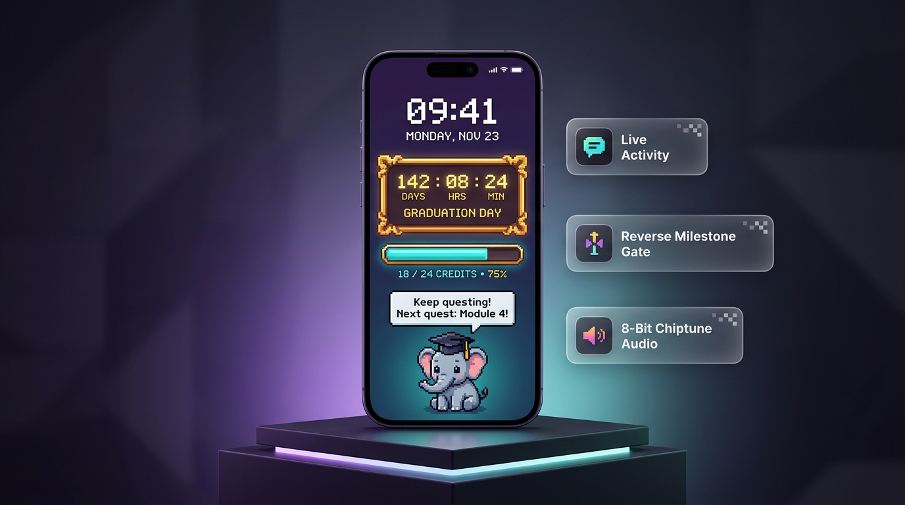
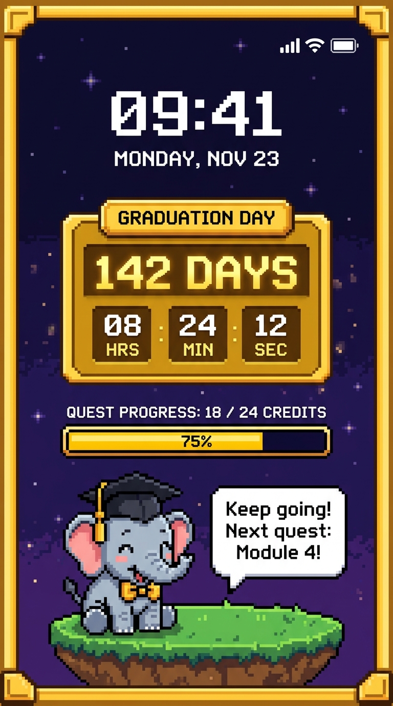

# 🎓 Quest to the Cap: 8-Bit RPG Graduation Countdown Lock Screen

[](https://daggerstuff.github.io/quest-to-the-cap/)
[](https://app.joinhandshake.com/)
[](LICENSE)

> **"Your Deadline, Your Design: Create a Countdown Lock Screen with Google"**  
> Official mission submission for the Handshake AI Skills Studio challenge (November 2026).

---



## 🌟 Overview & Design Philosophy

Traditional countdown timers induce **deadline anxiety** or fall victim to **Parkinson's Law**: when students see "142 Days Remaining," the goal feels either dangerously abstract (inviting procrastination) or overwhelmingly vast (causing paralysis).

**Quest to the Cap** transforms academic graduation into a classic 16-bit retro RPG quest. Instead of treating time as a countdown clock, this design reframes graduation as a **"Final Boss Stage"** and deconstructs the deadline into glanceable micro-commitments, visual XP health bars, and ambient companion motivation right on the smartphone lock screen.

---

## 🧭 The Reverse-Milestone Architecture

The core of the Handshake × Google challenge is **working backward from a deadline**. Our system maps the journey into four discrete hierarchical gates:

```
[ Gate 1: Foundations ] ──> [ Gate 2: Advanced Electives ] ──> [ Gate 3: Capstone Defense ] ──> [ Gate 4: Graduation Day ]
  12/24 Credits (DONE)       18/24 Credits (ACTIVE NOW)           T - 60 Days (UPCOMING)               T - 0 Days (FINAL BOSS)
```

1. **Gate 4 (T-Minus 0 Days — Final Boss):** Master graduation ceremony deadline tracked with tabular 8-bit precision (Days, Hours, Minutes, Seconds).
2. **Gate 3 (T-Minus 60 Days — Capstone Defense):** Portfolio verification and thesis review gate.
3. **Gate 2 (T-Minus 142 Days — Current Active Gate):** The immediate 2-week sprint (*"Module 4: Calculus Capstone"*). Surfacing **only** the active gate on the lock screen eliminates cognitive overload.
4. **Credit & XP Progression:** Translates 24 degree credits into an RPG experience bar (`18 / 24 Credits • 75% Level 18 Scholar`), giving instant dopamine for incremental progress.

---

## 📱 Mobile Mockup View

<p align="center">
  
</p>

---

## 🤖 AI Co-Creation & Technical Methodology

Prototyped and built in collaboration with **Google AI (Gemini)**:

* **Reverse Velocity Modeling:** Prompted Gemini with academic credit requirements and deadline dates to generate optimal pacing intervals, pacing checkpoints evenly across semesters to prevent end-of-term crunch.
* **Procedural 8-Bit Web Audio Synthesizer:** Generated a zero-dependency Web Audio API sound synthesizer that procedurally crafts retro square and triangle wave chiptune sounds for coin grabs, level-ups, and victory fanfares.
* **OLED Cognitive Ergonomics:** Engineered an ultra-low power dark theme (`#11162c`, `#242044`) utilizing 92% low-draw OLED pixels and high-contrast gold (`#ffd46c`) and mint (`#65d9b1`) typography for instant sunlight readability.
* **Vector Mascot Assets:** Co-designed coordinate layouts for **Ellie** (the pixel elephant mascot in a graduation cap), providing contextual study encouragement right above the lock screen swipe bar.

---

## ✨ Interactive Features in the Live Demo

Visit the **[Live Interactive Demo](https://daggerstuff.github.io/quest-to-the-cap/)**:

| Feature | Description |
| :--- | :--- |
| **📸 1-Click Wallpaper Exporter** | Renders a high-resolution 1080x1920 PNG lock screen wallpaper via HTML5 canvas and downloads it instantly for your actual device. |
| **🔊 8-Bit Chiptune Audio** | In-browser Web Audio synthesizer for nostalgic retro sound effects without loading audio files. |
| **🗺️ Reverse Roadmap Drawer** | Tap *"Reverse Path"* to slide out the backward-mapped milestone timeline. |
| **⏳ Live Activity Mode** | Tap *"Live Focus"* to toggle a 25-minute lock-screen study session widget inspired by Dynamic Island / At a Glance. |
| **⭐ Interactive XP Leveling** | Click `+1 Credit Earned` to see the XP bar advance, play coin audio, and trigger particle confetti. |
| **📺 CRT Scanline Shader** | Toggle nostalgic retro CRT scanlines and pixel starfield animations. |

---

## 🚀 Quickstart / Run Locally

No build tools, bundlers, or package managers required. Pure HTML5, CSS3, and modern JavaScript:

```bash
# Clone the repository
git clone https://github.com/daggerstuff/quest-to-the-cap.git

# Open directly in your browser
cd quest-to-the-cap
open index.html # or start a simple server: python3 -m http.server 8000
```

---

## 📄 License

Distributed under the [MIT License](LICENSE).
Made with 💜 for the **Handshake AI Skills Studio** challenge.
